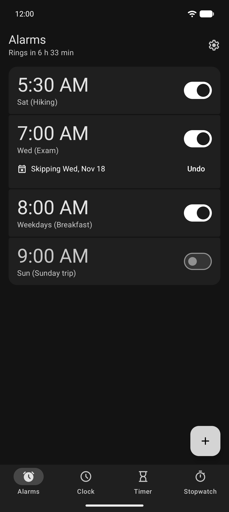
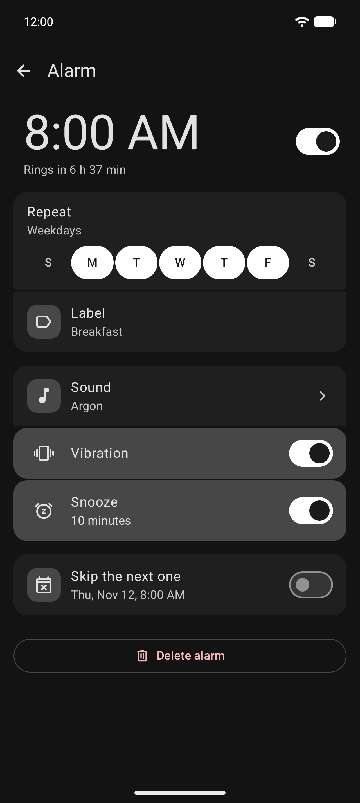
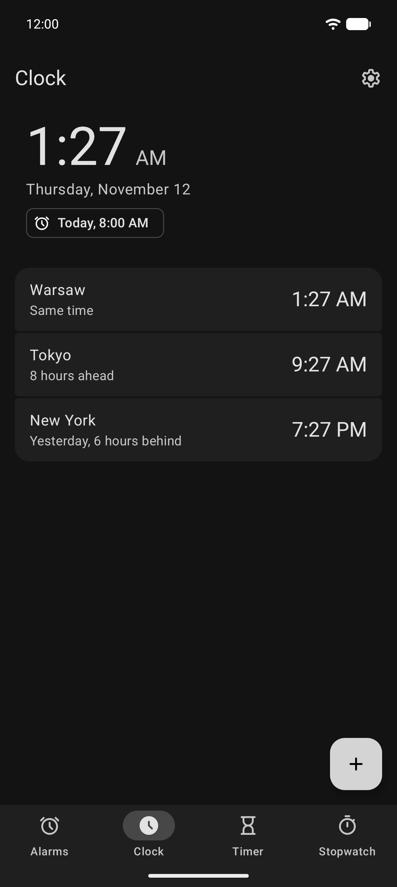
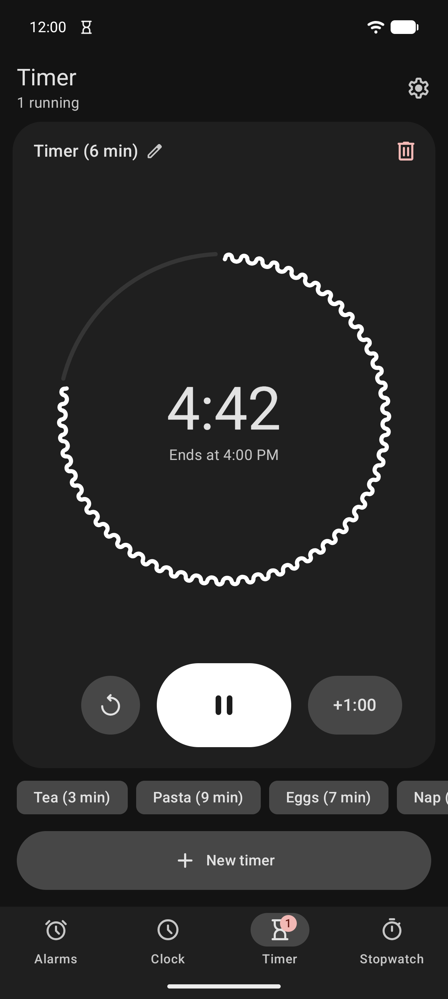
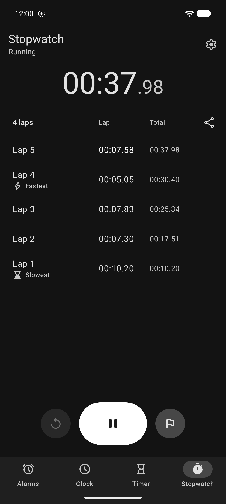
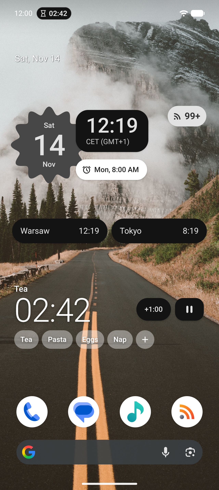

#  Clock

A private, offline clock for Android: alarms, world clock, timer and stopwatch.

**Current version**: v0.3.1

Source code and releases: [git.hnet.sh/hkr/clock](https://git.hnet.sh/hkr/clock)

Bug reports and feature requests: [github.com/legal-hkr/clock](https://github.com/legal-hkr/clock/issues)

## Overview

Clock is an alarm clock, world clock, timer and stopwatch with home-screen widgets. It has no Internet permission, doesn’t ask for your location, storage or media, and keeps nothing about you: alarms and settings stay on the device.

## Screenshots

     

## Features

### Alarms

- **Repeating or one-time**: Every day, weekdays, weekends or the days you pick, or once on a date; each alarm has its own label and sound
- **Skip the next one**: Leave out a single occurrence of a repeating alarm without switching it off
- **Ringing**: Full-screen alarm with slide to stop, snooze of the length you set, automatic silencing and gradually increasing volume
- **Before and after**: A notification ahead of an upcoming alarm, and one for an alarm you missed
- **Reliability check**: Clock warns when notifications, full-screen alarms, Do Not Disturb, battery restrictions or a zero alarm volume could keep an alarm from ringing

### World clock

- **Cities**: From the phone’s list of time zones, in the order you choose, each with its difference from local time
- **Home clock**: Shows the time at home while you’re in another time zone

### Timer

- **Several timers at once**, each with a label, and one more minute when you need it
- **Presets**: Start a timer with one tap, also from the home screen

### Stopwatch

- **Laps** with the fastest and slowest marked, ready to share

### Widgets

- **Digital clock** with the date and the next alarm, **round digital clock** and **analog clock**, both with an optional see-through shape
- **World clock** with a floating pill for each city
- **Clocks without a background**: digital, small digital, analog and world clock, directly on the wallpaper
- **Timer without a background**: the running timer with its controls, and your presets
- **Stopwatch without a background**: the time with its controls, the current lap and the last two

### Settings

- **Backup and restore** of alarms, cities, timer presets and settings to a file you choose, also offered on the first start
- **Language**: English or Polish, independent of the system language
- **Formats**: Time and date formats and the first day of the week follow the phone’s settings

## Requirements

- Android 14 (API level 34) or higher

## Building

```bash
git clone https://git.hnet.sh/hkr/clock.git
cd clock
./gradlew assembleDebug
```

Set the Android SDK path in `local.properties` (`sdk.dir=…`) first. Unit tests run with `./gradlew test`.


## Contributing

Development happens on [git.hnet.sh](https://git.hnet.sh/hkr/clock), where the releases are published too. The [GitHub repository](https://github.com/legal-hkr/clock) is a read-only mirror, updated on every push, and the place to report problems:

- **Issues**: Open them on [GitHub](https://github.com/legal-hkr/clock/issues), with the app version and your Android version
- **Pull requests**: Welcome on GitHub as well, but they can’t be merged there – accepted changes are applied on git.hnet.sh and reach the mirror from there, so the pull request itself ends up closed rather than merged

## Tech stack

- **Language**: Kotlin
- **Min SDK**: Android 14 (API 34), **target SDK**: API 37
- **UI**: Jetpack Compose with Material 3 Expressive

## License

[GPL-3.0](https://www.gnu.org/licenses/gpl-3.0.en.html)

## Acknowledgments

- [Claude](https://claude.ai) by Anthropic – AI assistant that provided valuable support during the development process, helping with code implementation, architecture decisions, and documentation
